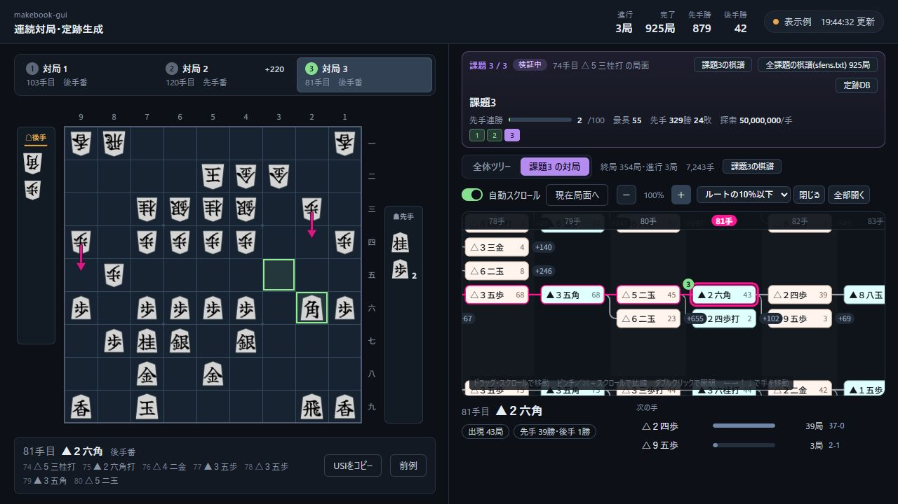

# makebook-gui

USIエンジンで連続対局を行い、定跡を生成するブラウザーアプリです。対局の開始・待機・再開と、盤面・ツリー・棋譜・定跡DBのWeb公開ができます。

定跡の更新処理は、たややんさんの [HiraganaSuisho / makebook2.py](https://github.com/tayayan/HiraganaSuisho/blob/main/makebook2.py) を基にしています。[比較と変更点](docs/ALGORITHM.md)も参照してください。

定跡生成配信の盤面・横方向のツリー・対局タブ・課題選択・連勝表示を使い、局面選択、矢印キーでの移動、ドラッグ、拡縮、自動追従ができます。「設定・開始」から共通起点・探索条件・課題一覧・連勝目標を指定します。



## 始める

Python 3.12と、別途用意したUSIエンジン・評価関数が必要です。Windowsで動作を確認しています。

Windowsでは `Start.cmd` をダブルクリックします。初回に依存パッケージを準備します。コマンドで起動する場合：

```powershell
py -3.12 -m venv .venv
.venv\Scripts\python -m pip install -r requirements.txt
.venv\Scripts\python app.py
```

開いたブラウザーの「設定・開始」で、エンジンの実行ファイルと探索条件を指定します。上部の「共通起点」は通常 `position startpos` のまま使い、課題局面のUSIは下の「課題を追加」から入力して「開始・再開」を押します。デスクトップGUIは不要です。設定と結果は `data/` に保存され、同じ設定で再開すると続きから動きます。ブラウザーを閉じても対局は継続します。

手数上限は総手数です。Hashはエンジン1つ当たりの値、使用スレッド数の目安は「スレッド数×同時対局数」です。設定を変えて開始すると別の保存先になり、それまでの結果も残ります。

「引き分けの扱い」は千日手と手数上限の両方に適用し、既定は先手負けとして定跡を更新します。公式の引分・未決着を実対局の後手勝ちへ変更する設定ではなく、先手の公式連勝にも加えません。

探索詳細の保存は既定でオフです。USI通信全文・PV・探索統計は保存せず、棋譜・定跡更新と再開に必要な情報・表示用の評価値を残します。調査用に必要な場合だけ設定画面でオンにできます。警告や障害の記録はオフでも残します。

課題は画面で追加・並べ替えできます。追加手順は共通起点からのUSI指し手（または共通起点につながる `position` 形式の手順）です。各課題の公式先手勝ちが指定の連勝数に達すると次へ進み、全課題が達成したら停止します。千日手・手数上限は先手勝ちに数えません。課題を指定しない場合は共通起点からの連続対局になります。

観戦画面では全体ツリーで課題までの経路を、課題別ツリーでその後の対局を見られます。全課題まとめての棋譜は `sfens.txt`（SFEN形式）、課題別の棋譜もSFEN形式、生成定跡はやねうら王DB形式で保存できます。

上部の開始局面欄にUSI手順だけを指定した場合も、その最終局面までを全体ツリーに残し、以降の対局は別のツリーに表示します。平手初期局面そのものを指定した場合は、全体ツリーは初期局面の1ノードになります。SFENで局面だけを指定した場合は、そこを表示の起点とし、指定されていない過去の手順を作りません。これは表示範囲の区切りで、課題一覧を指定しない場合の連続対局の終了条件は変わりません。

読み込み定跡DBはUTF-8のやねうら王形式です。採用数を省略した4列の指し手行にも対応します。新規開始時に一度読み込み、同じ保存先の再開には元DBを必要としません。

エンジンが `Threads`・`ResignValue` を宣言しない場合は、その項目を送らずエンジン既定値を使い、保存先の `runtime/workers/*/usi.jsonl` に警告を残します。指定したスレッド数・投了値が適用されるかはエンジンの対応を確認してください。`USI_Hash` は宣言を省略するエンジンにも送信します。

自動送信するオプションは、画面で指定した `Threads`・`USI_Hash`・`ResignValue` だけです。内蔵定跡（`BookFile`・`OwnBook`）、`EnteringKingRule`・評価関数・FV_SCALE・MultiPV・DrawValueなど、その他のエンジンオプションは変更しません。

## Web公開

- 操作画面：`http://127.0.0.1:8765/`
- 公開用の観戦画面：`http://127.0.0.1:8766/`（読み取り専用）

観戦ポート `8766` をリバースプロキシやTunnelへ接続します。Cloudflareの [Quick Tunnel](https://developers.cloudflare.com/tunnel/get-started/quick-tunnels/) で一時公開する例：

```powershell
cloudflared tunnel --url http://127.0.0.1:8766
```

表示されたURLを共有できます。Quick Tunnelは一時公開用で、固定URLの運用には通常のTunnel等を設定します。操作ポート `8765` は公開しません。

公開例：[定跡生成配信 202610](https://478shogi.com/makebook/202610/)

## 構成

```text
app.py        起動・ブラウザー操作・公開API
core/         USI通信・連続対局・定跡更新・保存
web/          操作画面・観戦画面
data/         設定・棋譜・定跡・復旧情報（自動生成、Git対象外）
tests/        本家ロジック比較・模擬エンジン検証
```

別の保存先やポートは `python app.py --data data-other --port 8775 --public-port 8776` で指定できます。

各保存先の `games.sfen` は終端付きの完了棋譜を追記し、進行中の棋譜は `games.live.sfen` に分けて保存します。対応する索引は `games.index.json` と `games.live.index.json` です。完了索引には確定したバイト数とSHA-256を記録し、追記の途中で終了した場合はSQLiteから復旧します。旧形式のアーカイブもSQLiteから再生成します。

公開APIは確定番号に応じて生成結果を共有し、棋譜・ツリーは新しい対局行だけを読み込みます。定跡DBの生成・合法性確認、JSON化・gzip圧縮も同じ確定状態では繰り返しません。公開用の生成処理と操作画面の制御ロックは分離しています。

```powershell
.venv\Scripts\python -B -m unittest discover -s tests
```

MIT License。エンジン・評価関数・第三者の定跡・認証情報は同梱しません。
